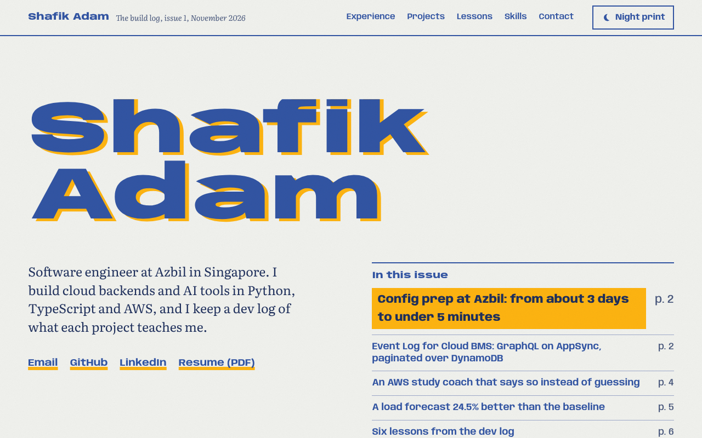
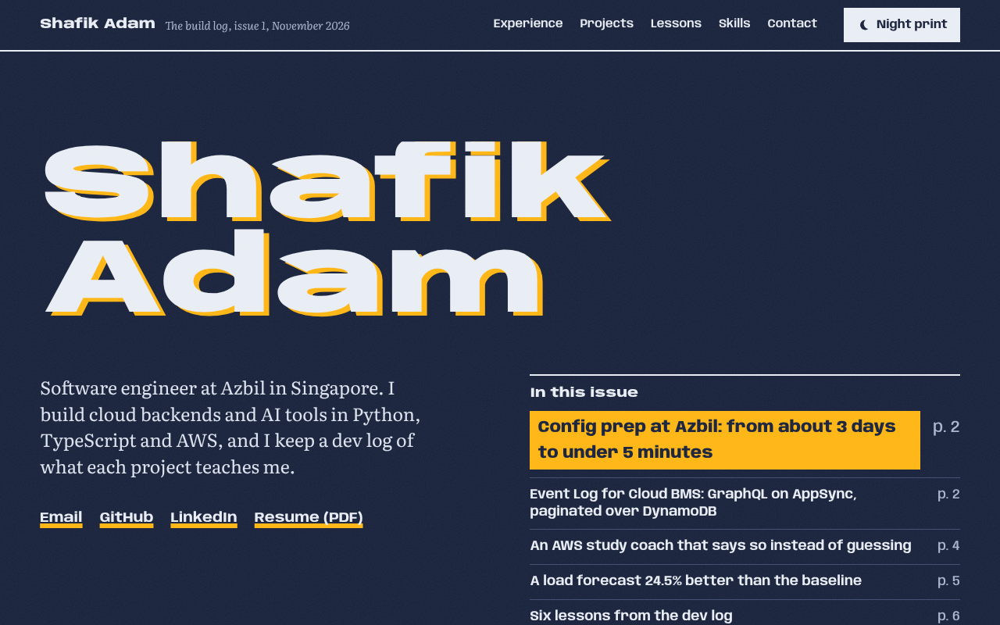
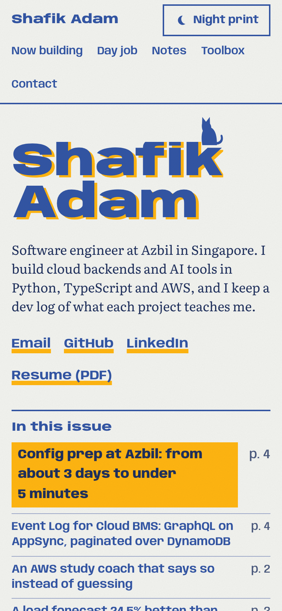
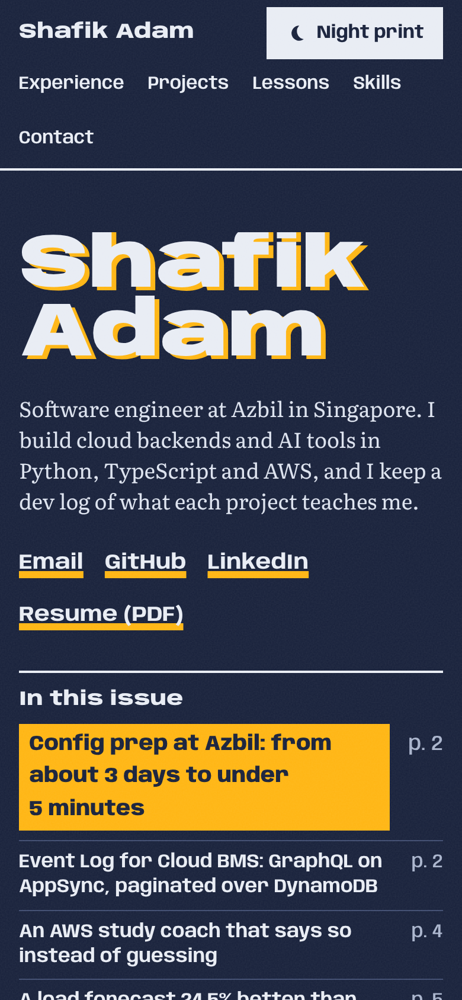

# v1.0.0: The build log, Issue 1

A new visual world. The isometric building is retired; the site is now **The build log**, a self-published two-ink riso zine by a builder and learner.

## What's new
- **Cover with cover lines.** The name is stamped in two inks. "In this issue" links straight to the proof with page numbers, led by config prep at Azbil (about 3 days to under 5 minutes) and the Event Log backend work.
- **Spreads, with plain names.** Experience first, then Projects (cumulus-coach, edge-energy-optimizer), Lessons learned, Skills and Education, then a back page, Contact.
- **Lessons learned.** Six lessons from the dev log that go beyond the numbers.
- **TypeScript, shown.** Cloud BMS is Svelte and AWS CDK in TypeScript; Skills now lists AWS CDK.
- **Two prints.** Day: riso blue and sunflower on white stock. Night: pale ink and sunflower on dark blue stock.
- **The print run.** On load the sunflower pass rolls across the name, then the blue ink lands. It's the only automatic motion; reduced motion shows the finished print.
- **Scroll print.** Section titles print their two inks as they scroll into view, following the scrollbar, and un-print when you scroll back. Built with GSAP ScrollTrigger, self-hosted, so the page loads no third-party scripts.
- **Personality, kept.** The riddle now opens a hidden centrefold (still a cake), with a button to reset the riddle and play again. A cat sits on the riddle card; another only comes out in the night print.
- **Type.** Anybody and Literata.

## Quality
- Design check passes: both prints at 390px and 1280px, axe at 0 violations, token contrast, 44px touch targets, the riddle and its reset, the scroll print, reduced motion.
- Reviewed by the recruiter critic (verdict: Interview) and Impeccable's finish reviewer; all material fixes applied. Reports in [`reviews/`](https://github.com/AD-NAP/portfolio/tree/main/reviews).

Decision record: [`docs/decisions/0002-riso-zine-redesign.md`](https://github.com/AD-NAP/portfolio/blob/main/docs/decisions/0002-riso-zine-redesign.md).

## Screenshots

**Day print, desktop**

**Night print, desktop**

**Day print, phone**

**Night print, phone**

