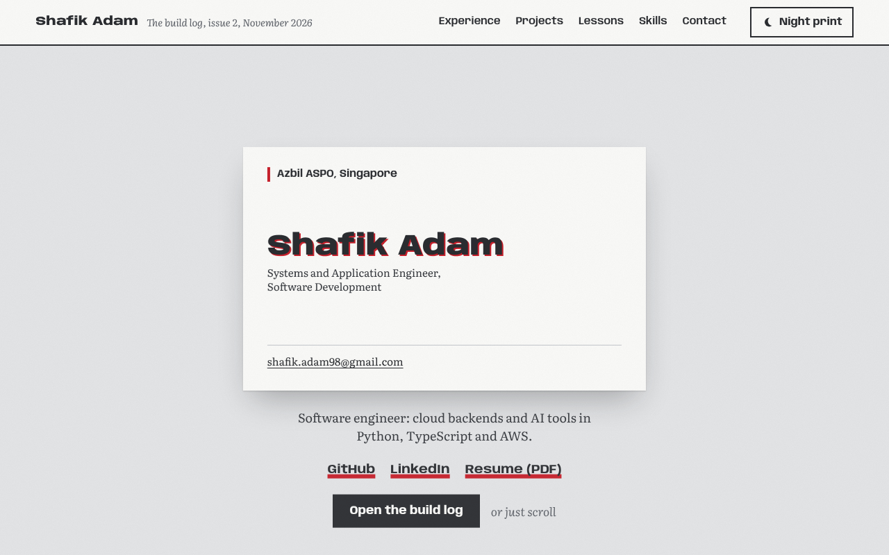
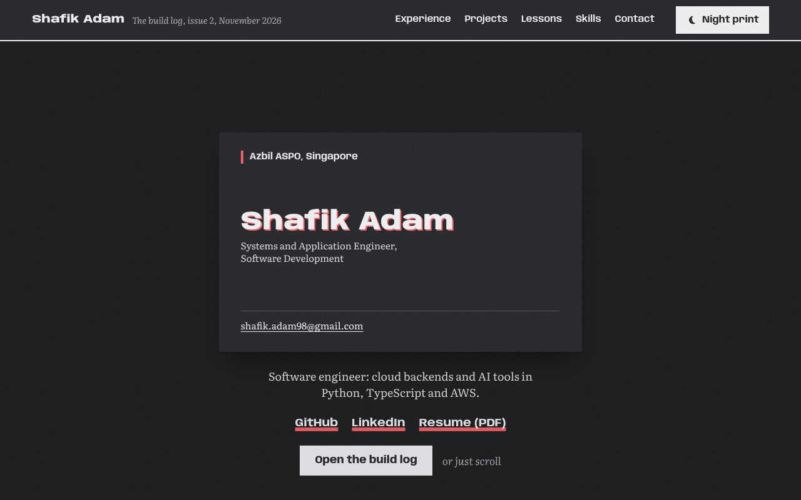
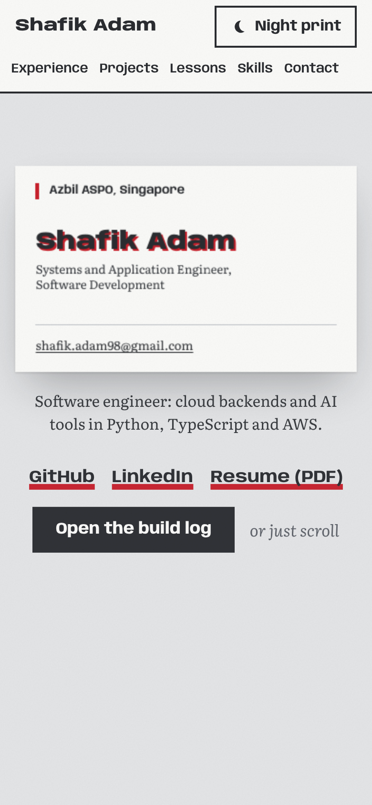
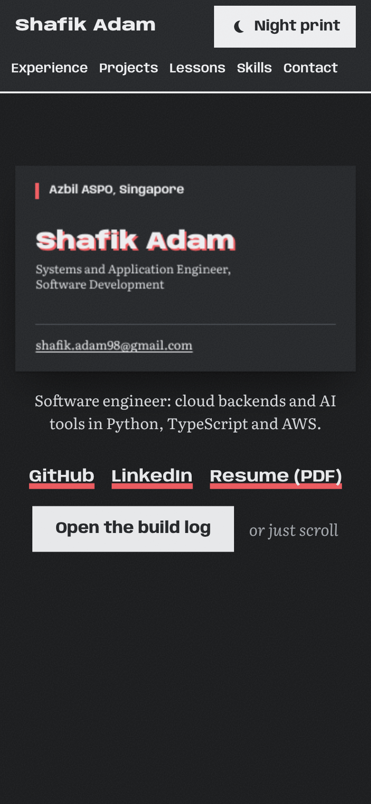
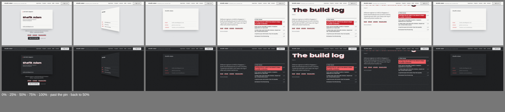
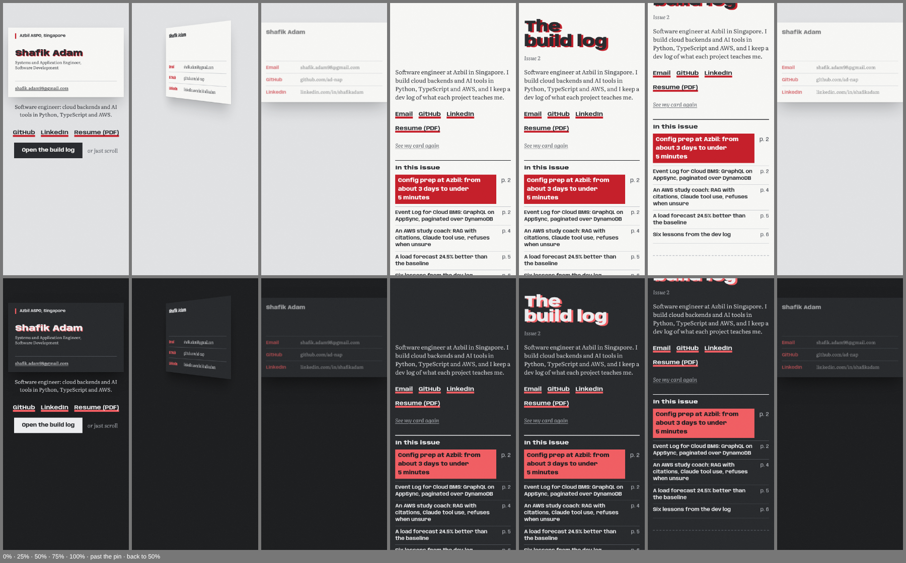

# v1.1.0: The build log, Issue 2

Issue 2 opens with a handshake. Before the zine, you get a name card.

## What's new
- **A name card first.** The site opens on a Japanese-style business card (meishi): "Azbil ASPO, Singapore", the name, the title and the email, on a desk. Under it: a one-line intro ("Software engineer: cloud backends and AI tools in Python, TypeScript and AWS"), GitHub, LinkedIn, the Resume PDF, and **Open the build log**.
- **Handed over properly.** On load the card rises into place with a slight bow, the polite way a meishi is offered. It's the only automatic motion.
- **The card becomes the cover.** Scroll, or press the button, and the card turns over in 3D, its back (the contact details) grows across the screen, and it becomes the zine's cover, whose title then receives its ink. It follows the scrollbar, so scrolling back up plays it in reverse. Same on phones.
- **Returning visitors** open straight on the cover, with "See my card again" to replay.
- **New inks.** Grey and red replace blue and sunflower. Day print: white stock, dark grey ink, red. Night print: dark grey stock, light grey ink, a brighter red. A lighter grey is the third tone.
- **Sharper cover lines.** "An AWS study coach: RAG with citations, Claude tool use, refuses when unsure."

## Quality
- Design check passes: both prints at 390px and 1280px, axe at 0 violations, token contrast, 44px touch targets, the riddle, the scroll print, reduced motion, and new tests for the card: on the first screen, the button opens the cover and focuses it, returning visitors open on the cover, the replay link, and keyboard focus never hides under the card.
- Reduced motion, or no JavaScript: no pin and no flip; the card and the cover are plain sections.
- Reviewed by the recruiter critic (Interview) and Impeccable's finish reviewer; all material fixes applied. Reports in [`reviews/`](https://github.com/AD-NAP/portfolio/tree/main/reviews).

Decision record: [`docs/decisions/0003-name-card-and-new-inks.md`](https://github.com/AD-NAP/portfolio/blob/main/docs/decisions/0003-name-card-and-new-inks.md).

## Screenshots

**Day print, desktop**

**Night print, desktop**

**Day print, phone**

**Night print, phone**

**The flip, desktop** (0%, 25%, 50%, 75%, 100% of the scroll, past it, and back to 50%)

**The flip, phone**

