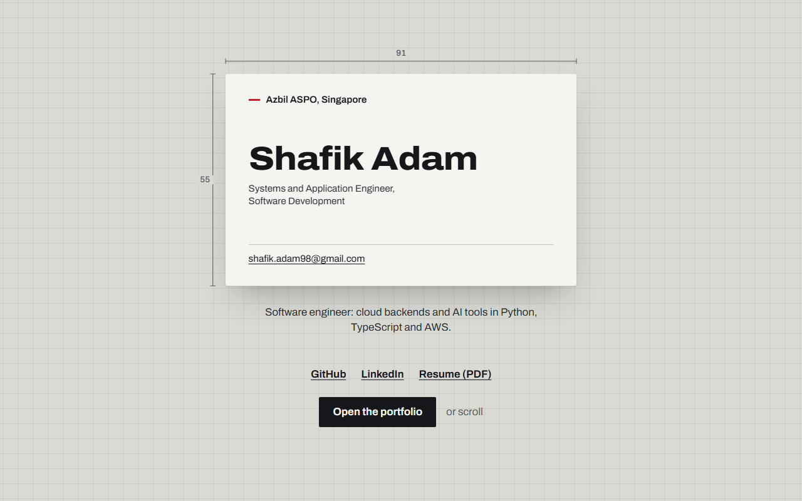
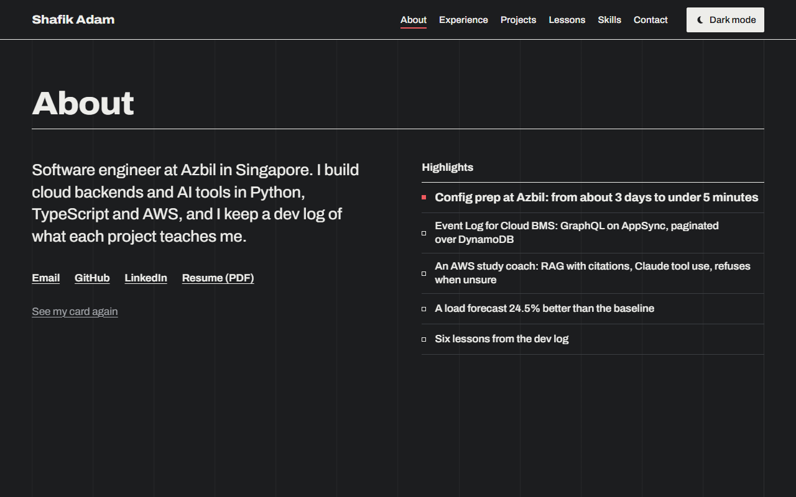
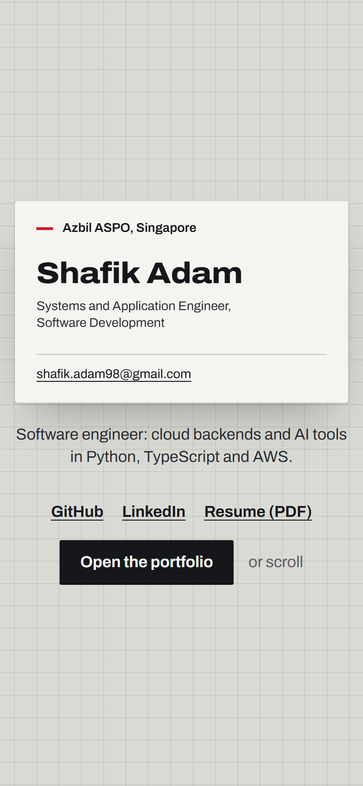
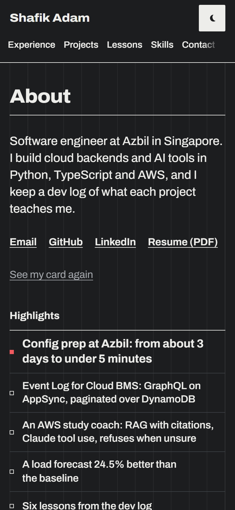
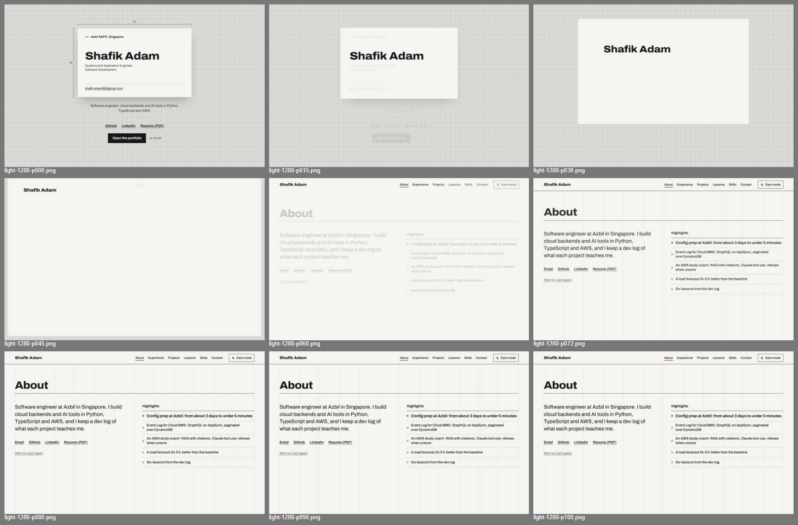
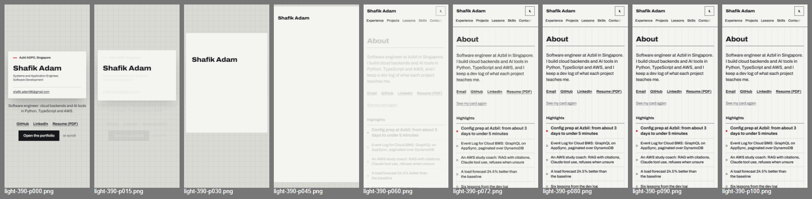

# v1.2.0: The card opens into the portfolio

The business card no longer flips into a zine. Now it opens into the portfolio itself, so the portfolio feels as if it was printed on the card all along.

## What's new
- **The card becomes the sheet.** Scroll, or press "Open the portfolio". The card's lines step aside, its stock grows into a full drawing sheet, the name moves up to the top bar, the links arrive from the right, and About fades in underneath. Scrolling back up plays it in reverse.
- **Smoother.** Only transforms and opacity move, and text is never scaled up, so every word stays crisp. The name lands exactly on the bar's name (within 1px, now a checker test) and swaps with it in one frame.
- **Never half-open.** Let go mid-way and it settles at the card or the portfolio, in the direction you were scrolling.
- **A new look: the drawing sheet.** A warm-grey sheet with a faint twelve-column hairline grid, almost-black ink, section titles on full-width rules, and a drawing title block as the footer. The dark theme is graphite with chalk-white ink. One typeface, Archivo, set wide and heavy for the name. The Azbil-like red stays as the one accent.
- **The card on a drafting desk,** with dimension marks: 91 by 55, the size of a business card.
- **Highlights** in About link straight to the proof, led by config prep at Azbil (about 3 days to under 5 minutes).
- **Charts** keep drawn-to-scale bars. Results are solid red, and baselines are hatched like a section cut.
- **The riddle stays.** It now opens a Bonus (still a cake), and you can reset it. The cats and the zine (issues, spreads, scroll-printed titles) are retired.

## Quality
- Design check passes: both themes at 390px and 1280px, axe at 0 violations, token contrast, 44px touch targets, the riddle open, reload and reset, and reduced motion (plain sections, nothing pinned). New card tests: the bar is hidden on the card and shown after, the name lands within 1px, the snap rests at an end. The checks on the button, returning visitors, replay and keyboard focus are retargeted to the new page.
- Every font size now comes from an eight-step type ramp. Impeccable's detector is clean, and DESIGN.md has been rewritten for the new world.

Decision record: [`docs/decisions/0004-card-into-portfolio.md`](https://github.com/AD-NAP/portfolio/blob/main/docs/decisions/0004-card-into-portfolio.md).

## Screenshots

**The card, light, desktop**

**Opened, dark, desktop**

**The card, light, phone**

**Opened, dark, phone**

**The transition, desktop** (0% to 100% of the scroll)

**The transition, phone**

