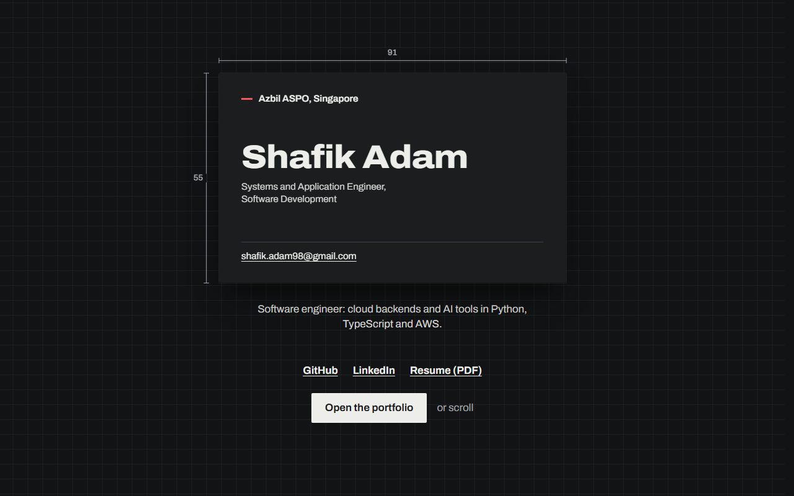
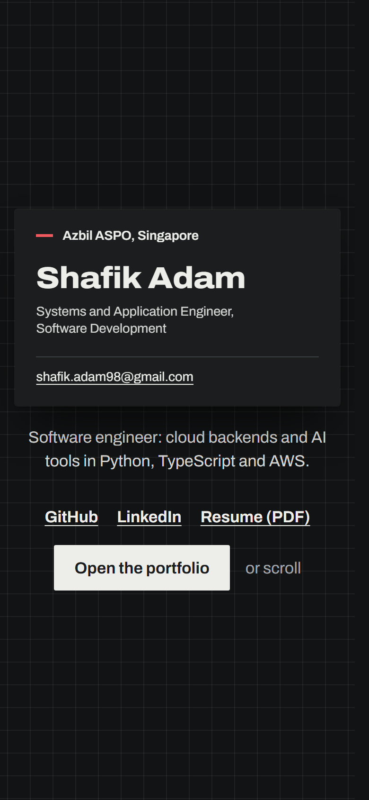
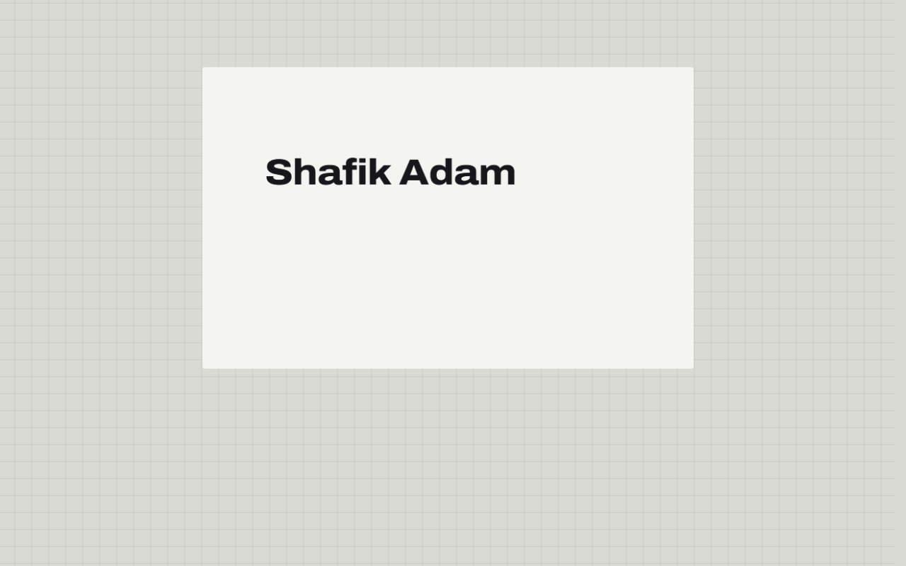

# v1.2.1: One pace for the card, dark by default

Fixes to v1.2.0's card-to-portfolio transition, and a new default theme.

## What's changed
- **Any scroll opens the card.** One notch of the wheel, a small trackpad flick, a swipe up on a phone, or Space, PageDown or ArrowDown plays the whole transition. You no longer need to scroll through it.
- **One pace, every way.** The scroll, the keys and "Open the portfolio" all take the same 1.5s. The button used to rush through it in about half a second.
- **Back to the card.** At the very top of the page, scroll up (or swipe down) to play it back in the same 1.5s. Everywhere else the page scrolls normally. "See my card again" does the same.
- **Turn around any time.** Change direction mid-way and it reverses smoothly.
- **Dark by default.** First-time visitors get the dark theme. The toggle remembers your choice.

## Quality
- Design check passes: both themes at 390px and 1280px, axe at 0 violations, token contrast, 44px touch targets, the riddle, reduced motion (plain sections, no lock). New tests check that the button and one small wheel step are both still under way at 0.5s and finished by 2.2s, that scrolling up at the top closes the card, that the page scrolls normally once open, and that a light-mode system still gets the dark theme by default.
- The page's heading stays available to screen readers after the card opens.

Decision record: [`docs/decisions/0004-card-into-portfolio.md`](https://github.com/AD-NAP/portfolio/blob/main/docs/decisions/0004-card-into-portfolio.md) (revised in v1.2.1).

## Screenshots

**The card, dark (the new default), desktop**

**The card, dark, phone**

**Half a second after one wheel step: the card's paper growing into the sheet**

