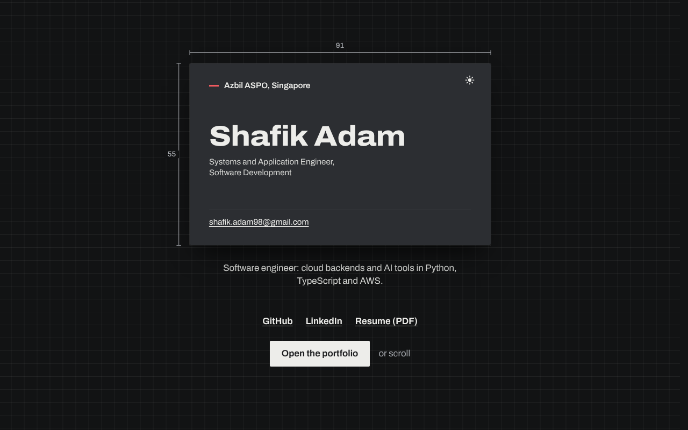
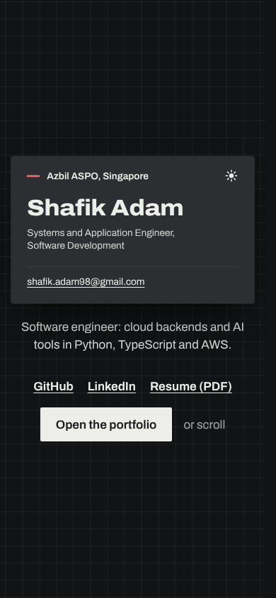
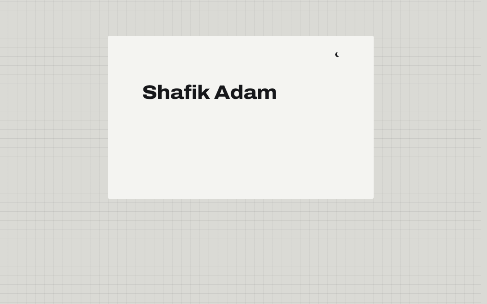
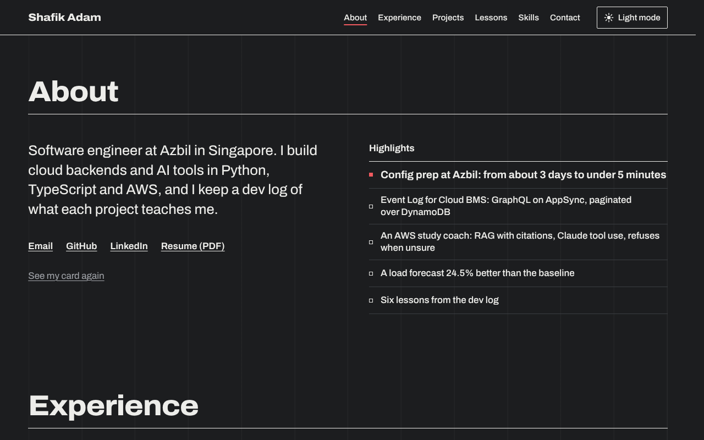

# v1.2.2: Always the card, and a theme switch that travels

Small changes to v1.2.1, asked for by Shafik.

## What's changed
- **Always the card.** Every visit opens on the business card. The page no longer remembers that you've seen it. A link to a section (for example `#projects`) still goes straight there.
- **A card you can see in dark mode.** The card is now a lighter graphite with a crisper edge, so it stands off the dark desk. As it grows into the sheet it fades to the sheet's colour. Light mode is unchanged.
- **A sun or moon on the card.** The card's top-right corner has a theme switch. As the card opens, its icon walks into the bar's theme button, the way the name walks to the bar's name.
- **Buttons that say what they do.** Both theme buttons show the theme they switch to: a sun and "Light mode" in dark, a moon and "Dark mode" in light.

## Quality
- Design check passes: both themes at 390px and 1280px, axe at 0 violations, token contrast (now including text on the card's stock), 44px touch targets, the riddle, reduced motion. New tests check that every visit opens on the card (even for a visitor the page used to remember), that the card's icon lands within 1px of the bar's, and that the card's switch changes the theme, the icon and both labels.

## Screenshots

**The card, dark, desktop**

**The card, dark, phone**

**Opening, light: the moon on its way to the bar**

**Open, dark: the sun in the bar's "Light mode" button**

