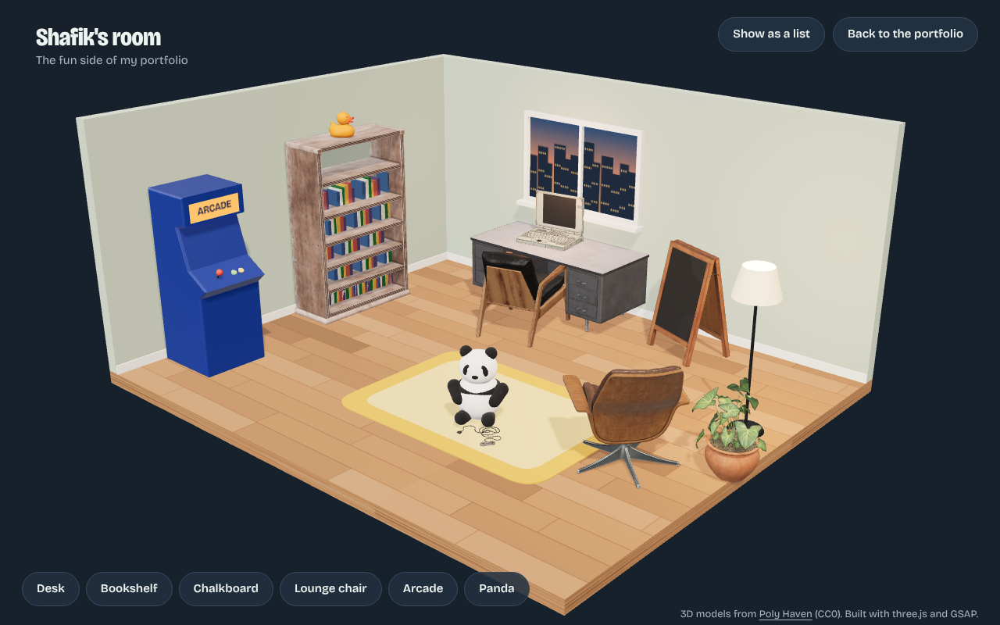
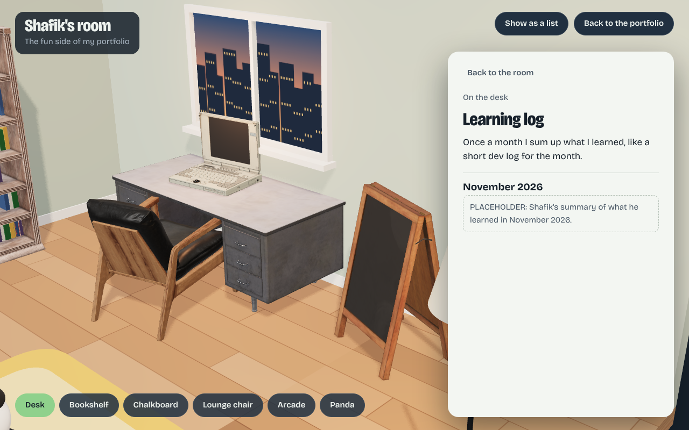
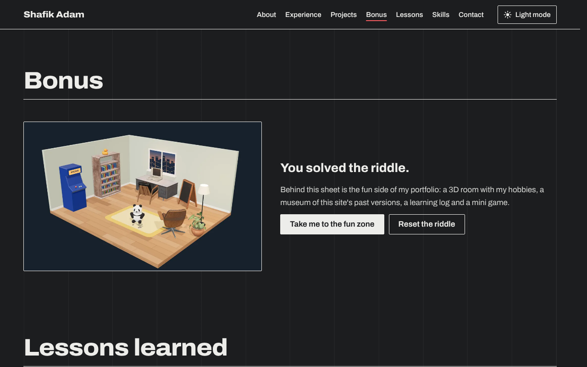
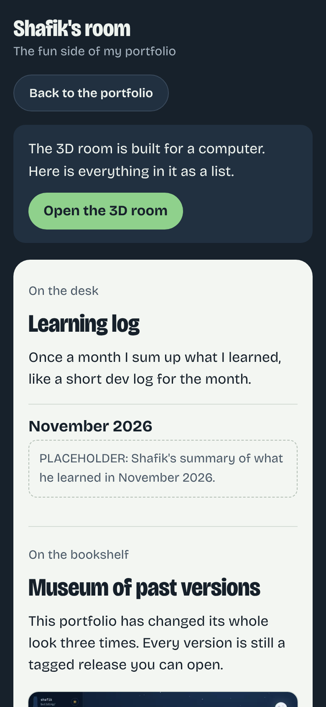

# v1.3.0: The fun side

Solving the riddle now leads somewhere: a 3D room behind the drawing sheet, where the fun side of the portfolio lives.

## What's new
- **A 3D room** at `/portfolio/back/`, built with Three.js. Detailed, CC0 models from Poly Haven sit in an evening room in Singapore: a desk by a window, a bookshelf, a chalkboard, a lounge chair, an arcade cabinet and a panda on the rug.
- **Six things to choose.** Click one, or use the row of buttons, and the camera glides to it while a panel opens beside it:
  - Desk: a monthly learning log
  - Bookshelf: a museum of this site's past versions (the building, the zine and the drawing sheet), each linked to its release
  - Chalkboard: future goals
  - Lounge chair: hobbies
  - Arcade: Squash the bugs, a ten-second mini game
  - Panda: a hello from the mascot hiding in `ad-nap`
- **Its own look.** The fun side doesn't follow the drawing sheet: slate-blue night, warm light, bamboo green and Bricolage Grotesque.
- **The way in.** The Bonus now shows a still of the room in place of the cake. "Take me to the fun zone" grows it to fill the screen, and the room picks up where the zoom left off.
- **A plain list for everyone else.** Phones, reduced motion and browsers without 3D get all the same content as a simple list, with a note. They never download Three.js or the models.

## Quality
- Design check passes: both themes at 390px and 1280px, axe at 0 violations, contrast, 44px touch targets, the card, the riddle, reduced motion.
- New tests: the main page loads no Three.js, the zoom into the room, the phone note, the room drawing (software WebGL), the dock and Escape, the list view, reduced motion, and axe on the room and both lists.

## Screenshots

**The room**

**The desk and the learning log**

**The way in: the Bonus, dark**

**On a phone: the list**

