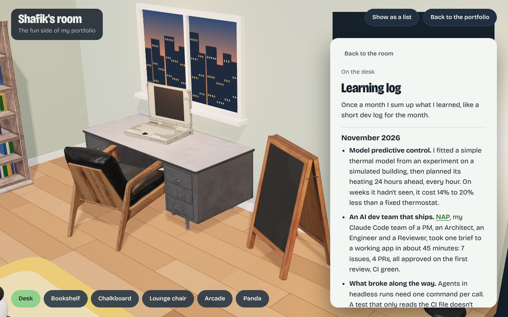
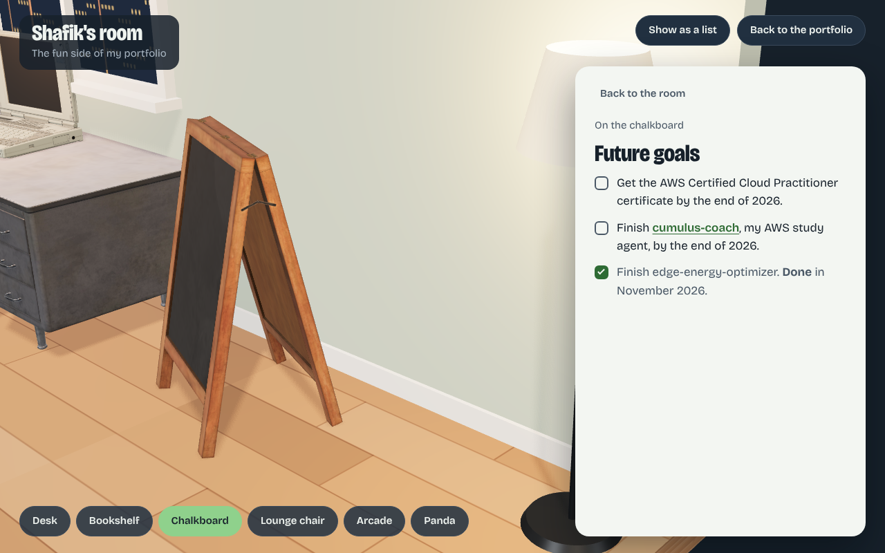
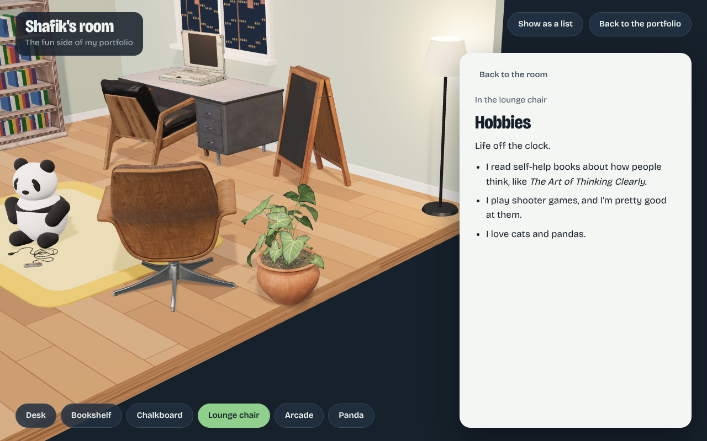
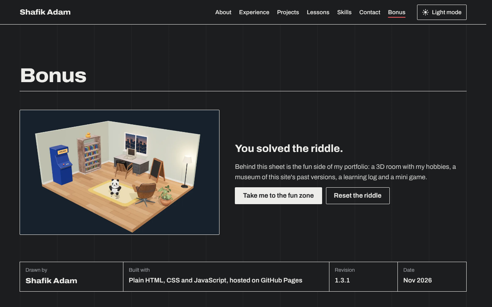

# v1.3.1: The fun side gets its content

Follow-ups to v1.3.0, asked for by Shafik.

## What's changed
- **Learning log (the desk).** Summaries of October and November 2026, from my own dev logs and notes: model predictive control, NAP (my Claude Code dev team), what broke along the way, this site, load forecasting, RAG and tool calling, and Claude Code's building blocks.
- **Future goals (the chalkboard).** The AWS Certified Cloud Practitioner certificate and cumulus-coach by the end of 2026; edge-energy-optimizer ticked off as done.
- **Hobbies (the lounge chair).** Self-help books on how people think, shooter games, and cats and pandas.
- **The Bonus moves below Contact,** right after the riddle that opens it, in the page and in the bar. The evidence now reads without a break.
- **Fixes:** a link to `#bonus`, such as "Back to the portfolio" from the room, now lands on the Bonus (it used to stop short while the section was still hidden). The floor lamp moved into the corner so it no longer blocks the chalkboard.

## Quality
- Design check passes: both themes at 390px and 1280px, axe at 0 violations, contrast, 44px touch targets, the card, the riddle, reduced motion, and every fun-zone test.

## Screenshots

**The learning log**

**Goals on the chalkboard**

**Hobbies**

**The Bonus, now after Contact**

