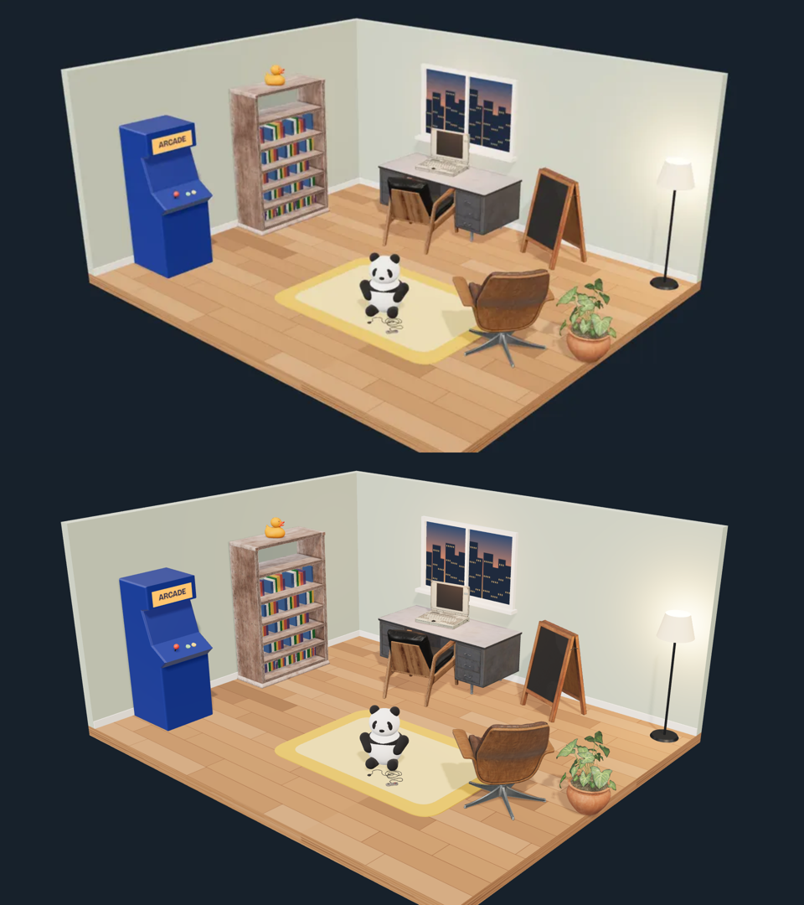
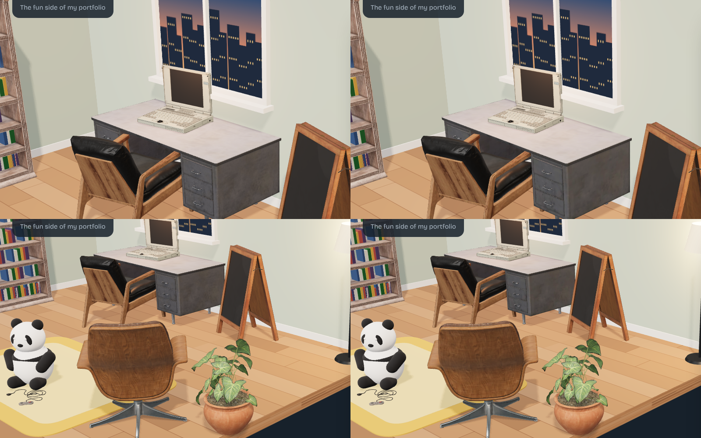

# v1.3.2: A room that's ready before you click

Asked for by Shafik: the wait after "Take me to the fun zone" was too long.

## What's changed
- **Loads in the background.** Once you've solved the riddle and the Bonus comes into view, the room downloads quietly while you read. On a desktop only, never before the riddle, never on phones, and not with Data Saver or reduced motion. A normal visit downloads nothing extra.
- **7× lighter textures.** The models' textures are WebP now: 14.9 MB down to 2.2 MB, with no visible difference. The whole room is about 6 MB.
- **No gap after the zoom.** The room page opens on the same picture the zoom ended on, gets the live room ready behind it, then crossfades in. The two line up exactly at any screen shape, so nothing jumps.

## Measured
In headless Chromium on a throttled 20 Mbit/s connection, from the click to the live room:

| | Time |
|---|---|
| v1.3.1 | 13.9s |
| v1.3.2, clicking straight away | 10.0s |
| v1.3.2, after a few seconds on the Bonus | 8.4s, all from the cache |

About 6.8s of every run is software rendering on the test machine, which a real graphics card does far faster. The picture covers the rest.

## Quality
- Design check passes, with new tests: nothing from the fun side loads before the riddle; after it, every file the room needs is prefetched on a desktop and never on a phone; the manifest lists everything the room loads; the room page opens on the picture and the live room replaces it.

## Screenshots

**The picture (top) and the live room (bottom), 1920 × 1080**

**JPEG (left) and WebP (right) textures**

