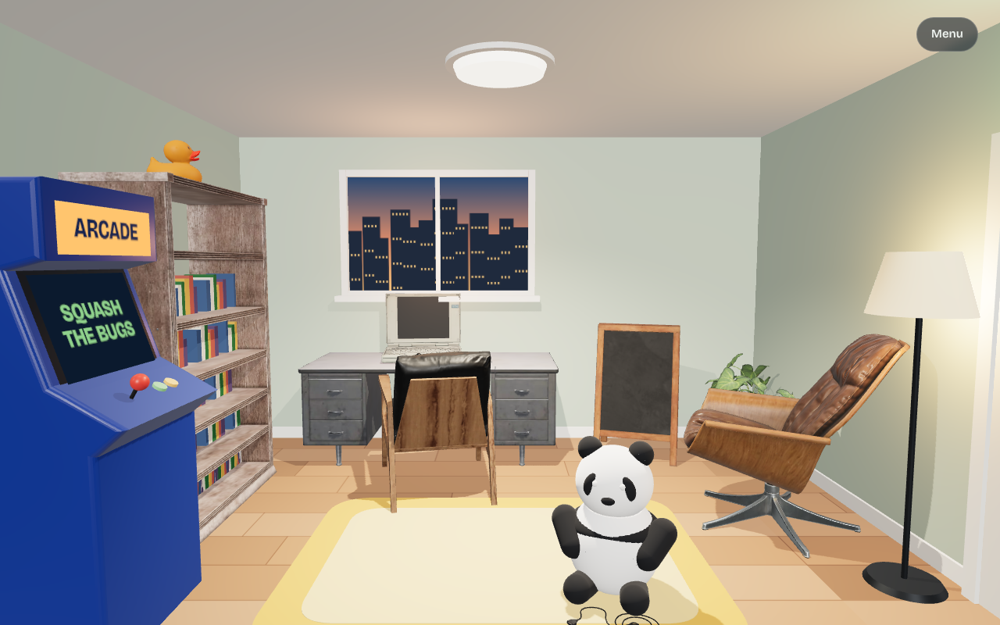
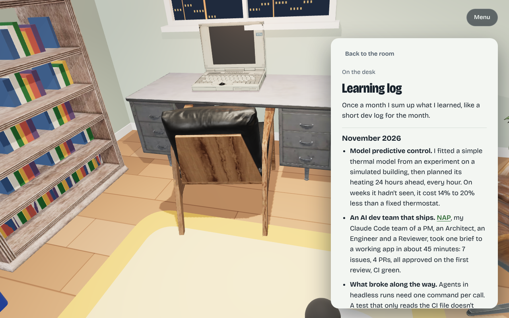
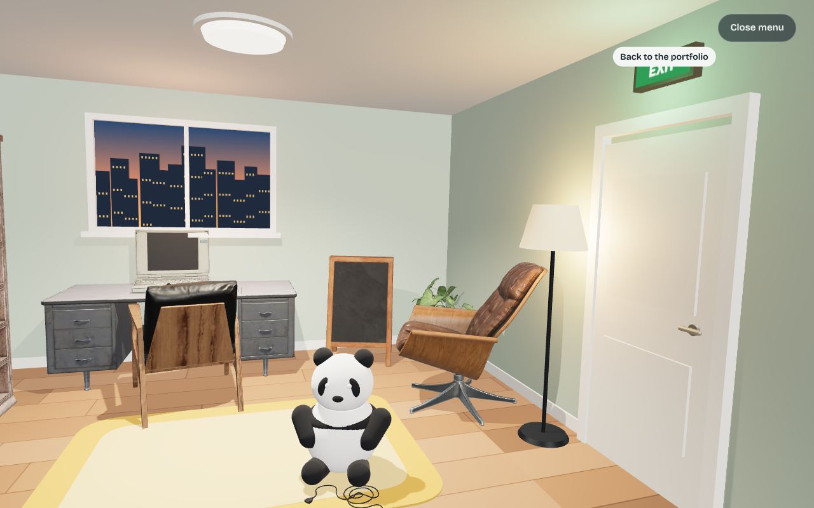

# v1.4.0: Standing in the room

Shafik wanted the fun side to feel like being in the room, not looking at a model of it.

## What's new
- **First person.** You stand at the open side of the room at eye height, facing three walls, a floor and a ceiling with a round ceiling light.
- **Look around with the mouse.** Moving the mouse turns your head up to 30° left and right and 10° up and down, easing smoothly. The arrow keys work too.
- **Walk right up to things.** Click the arcade and you're face to face with its screen; the desk, the bookshelf, the chalkboard, the lounge chair and the panda each have their own spot. The panel opens beside it; Esc or "Back to the room" steps back.
- **Out of the way UI.** In the room only a quiet "Menu" button shows. Menu, Esc or Tab bring back the title, the list view, the way back and the row of things. A short hint on arrival explains it.
- **An EXIT door.** A door on the right wall, with a glowing sign, leads back to the portfolio.
- **Ready sooner.** Desktops start downloading the room (about 6 MB, at the lowest priority) once the card has opened into the portfolio, not only after the riddle. Phones still never download it.

## Quality
- Design check passes. New tests: the mouse turns the view and stops at 30°; only "Menu" shows on arrival; Menu, Esc and Tab bring the UI back; up close the UI stays hidden; each close-up ends next to its thing; the door goes back to the Bonus; nothing downloads while the card is closed, and everything does once it opens.

## Screenshots

**Standing in the room**

**Face to face with the arcade**

**At the desk: the learning log**

**Looking right: the EXIT door**

