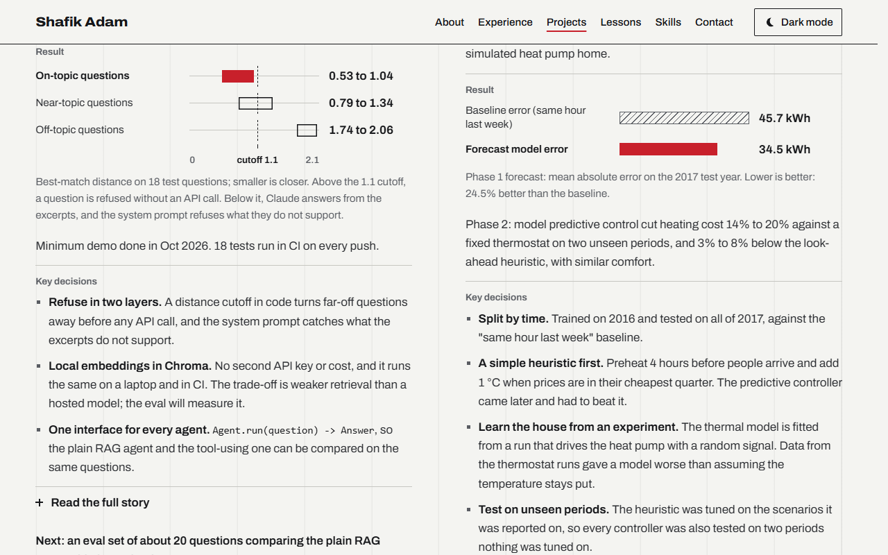
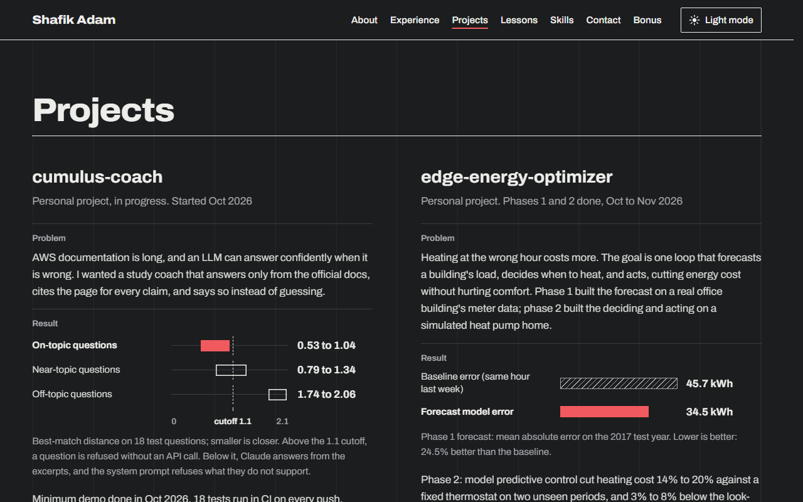
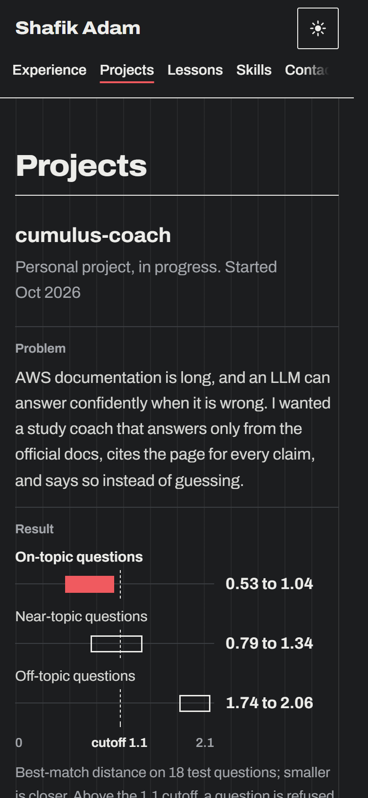

# v1.5.0: Projects as engineering stories

Shafik wanted the projects to show how he thinks, not only what he built.

## What's new
- **Each project is a story.** Problem, Result and Key decisions are always shown, so the number and the reasoning are visible at a glance. Result comes before Decisions on purpose.
- **The full story, one click away.** "Read the full story" unfolds Constraints, Architecture, Implementation and What went wrong. It is a plain HTML disclosure: it works from the keyboard, with no script and no animation.
- **cumulus-coach:** why it refuses in two layers, why local embeddings, and why every agent sits behind one interface so the eval can compare them fairly.
- **edge-energy-optimizer:** one loop from forecast to action; split by time, a simple heuristic first, a thermal model learned from an experiment, unseen test periods; and what went wrong (a controller that heated an empty room to 30 °C, and data leakage that took three tries to remove).
- **Phone charts line up.** Every chart row now has one fixed value column, so the bars and the axis under them are the same width and the cutoff label sits on its line.

## Quality
- Design check passes. New tests: the stories start folded; Enter and a click open them, another click folds them; a 2px focus ring; 44px touch target on phones; the Highlights still land on each project; axe, overflow and screenshots with every story unfolded.
- Recruiter critic: Interview (junior to lower-mid level). Its fixes to repetition, edge's Problem, the status line and the footer are in. Report: `reviews/2026-11-24-recruiter-critic-v1.5.md`.

## Screenshots

**The stories as a recruiter first sees them**

**Unfolded, in dark**

**On a phone, the chart lined up with its axis**

